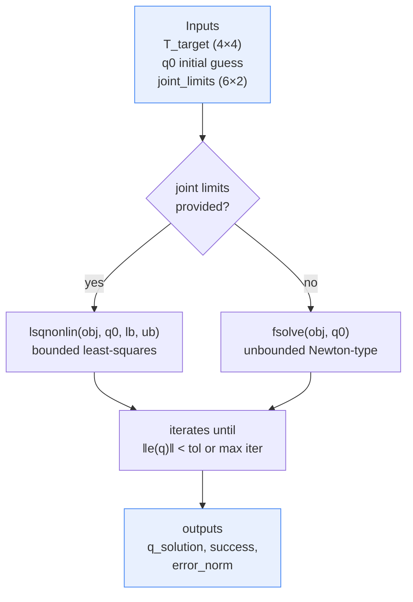
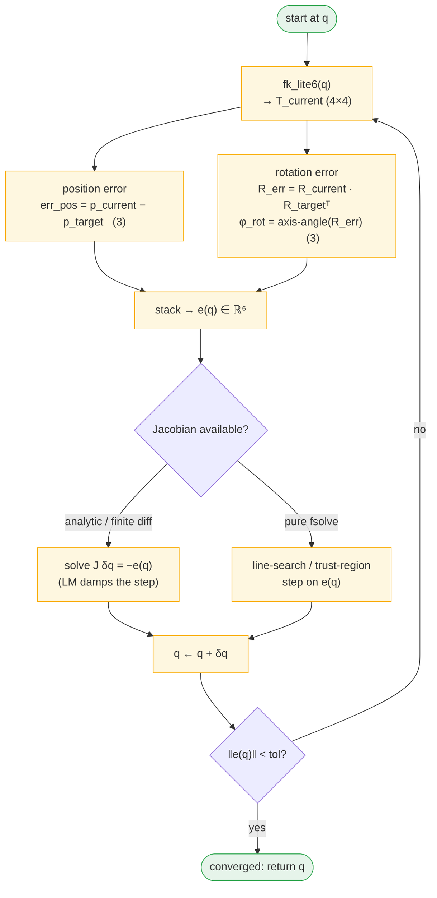
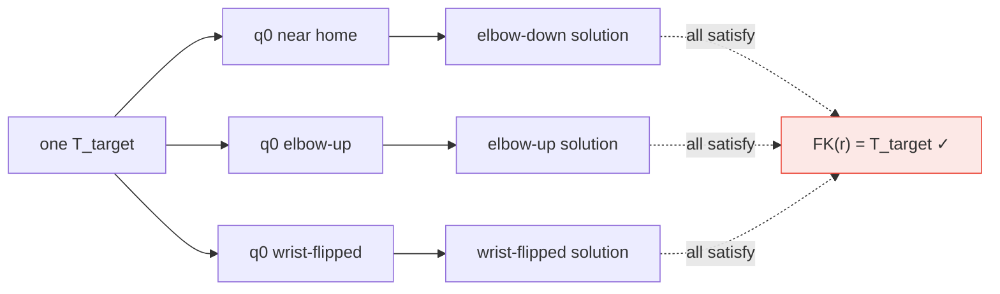
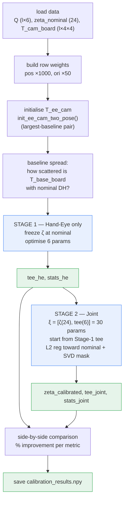
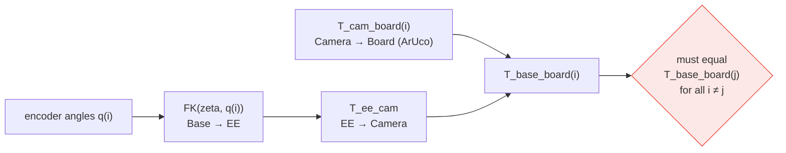
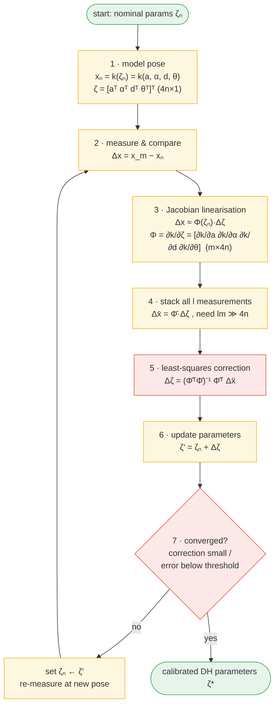
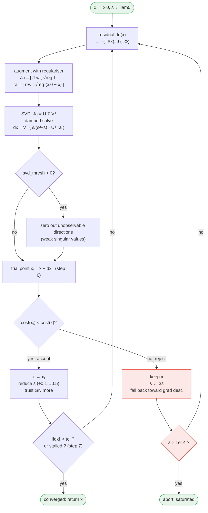
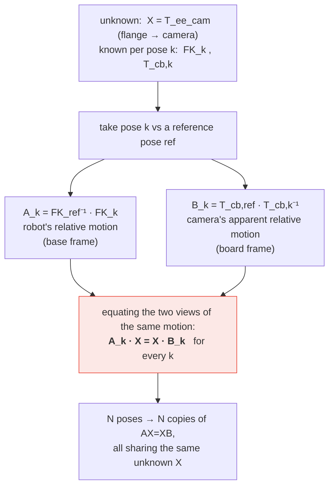
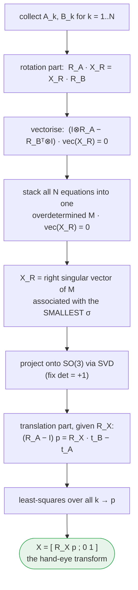

# Lab 2 — What's Happening Behind the Black Box

Flowcharts for the two numerical engines in this lab: **inverse kinematics** (Part A, MATLAB) and **DH + hand-eye calibration** (Part B, Python). Each diagram is annotated with the exact function it corresponds to, so you can follow the picture straight into the code.

---

## Part A — Numerical Inverse Kinematics

The IK solver is a root-finding loop wrapped around forward kinematics. The "black box" is really three stacked layers: an outer iteration loop (`ik_solve`), a residual evaluator (`ik_objective`), and the FK that turns joint angles into a pose (`fk_lite6`).

### A1. Top level — one IK call

*Code:* `ik_solve.m`. The only difference between the two branches is whether the joint-limit bounds are passed to the solver; both minimise the same objective.

### A2. The inner loop — what each iteration actually does

This is the heart of the method. At every step the current guess is pushed through FK, compared to the target, and the mismatch tells us how to nudge the joints.

*Code:* `ik_objective.m` builds `e(q)` (top half = position, bottom half = orientation via the trace formula `acos((tr(R_err)−1)/2)` and the skew part for the axis). `ik_solve.m` supplies the stepping rule.

### A3. Why several answers exist (solution multiplicity)

For a fixed target pose the map `q ↦ T(q)` is many-to-one, so the loop lands wherever its starting basin points. Different `q0` values fall into different basins.

This is exactly what Test 3 in `ik_numerical.m` demonstrates by firing off five guesses at the same target.

---

## Part B — DH + Hand-Eye Calibration

Calibration looks like one big optimisation but it is staged. First a cheap hand-eye-only pass gets us close, then a joint pass refines everything while regularisation keeps the DH parameters from drifting into nonsense. Both passes run the *same* LM engine below.

### B1. Overall pipeline

*Code:* `run_calibration_twostage.py`. Notice Stage 2 seeds its hand-eye block with Stage 1's result (`xi0_joint = [zeta0, tee_he]`) — that seeding is what makes the 30-parameter problem well-behaved.

### B2. The constraint being enforced (per pose)

Every pose must predict the *same* board location, because the board never moves. That single fact generates all the residuals.

Residuals are measured against pose 0 as the reference: for each pose `i ≥ 1`, `r_i = V₀ − V_i` where `V` is the 6-vector `[position, axis-angle]` form of `T_base_board`. Pose 0's own block is identically zero.

> **Why multiply rotations and take a log instead of just subtracting Euler angles?**
>
> The position half of the residual is an ordinary subtraction — positions live in flat 3D space, so `p_ref − p_i` is fine. Orientation is different: a rotation is a 3×3 matrix on a curved surface, not a point in flat space, so you can't meaningfully subtract two of them or their Euler angles and get a clean "error."
>
> Two problems with the naive approaches:
> - **Subtracting rotation matrices** (`R_ref − R_i`) gives something that isn't even a valid rotation, so it doesn't represent any real orientation difference.
> - **Subtracting Euler angles** sounds tempting but depends on which angle convention you chose, and it misbehaves badly near gimbal lock (where one angle becomes undefined). The result also isn't a true measure of "how far apart" the two orientations are.
>
> So we do this instead. First, combine the two orientations into *one* rotation that represents only their disagreement: `R_rel = R_refᵀ · R_i`. If the two match, `R_rel` is the identity (zero error); if they differ, `R_rel` is "the little rotation that takes one to the other." Then the **log map** converts that single rotation into a plain 3-number vector: its length is the angular difference (in radians) and its direction is the axis you'd rotate about. That vector plays exactly the same role as a position error — it can be scaled, added, and dropped into the Jacobian — so the orientation rows flow through the same least-squares machinery as the position rows.
>
> Think of it this way: near where you're standing, the curved surface of "all possible orientations" looks almost flat. The log map reads off your error *on that local flat patch*, which is accurate precisely because our residuals are small (we iterate toward consistency, so we never wander far). Once everything is flattened to vectors, the rest of the calibration is ordinary linear algebra.

*Code:* `predict_all_Tbb()` composes the chain; `compute_residuals_and_jacobian()` flattens the deviations and estimates `J` by finite differences over all 30 parameters.

### B3. The calibration loop — Sciavicco & Siciliano §2.11 kinematic calibration

The heart of Part B is the iterative Jacobian correction described in Sciavicco & Siciliano, *Modelling and Control of Robot Manipulators* (2nd ed., 2000), **Section 2.11 "Kinematic Calibration," pp. 64–66**. Both stages run this same loop; they differ only in how many parameters are allowed to move. Their seven steps map onto our code almost one-for-one:

| S&S step | What it says | Where it lives in our code |
|---|---|---|
| 1. Model pose | `x = k(ζ)`, `ζ = [aᵀ αᵀ dᵀ θᵀ]ᵀ` (4n×1) | `fk_from_zeta()` / `predict_all_Tbb()` — same packing order |
| 2. Measure & compare | `Δx = x_m − x_n` | residual `r` in `compute_residuals_and_jacobian()` (board-pose deviation from reference) |
| 3. Linearise | `Δx = Φ(ζₙ) Δζ`, `Φ = ∂k/∂ζ` (m×4n) | Jacobian `J` (finite-difference stand-in for analytic `Φ`) |
| 4. Stack, need lm ≫ 4n | `Δx̄ = Φ̄ Δζ` over l points | `(6l × 30)` stacked Jacobian; ~60 poses ⇒ 360 eqns ≫ 30 unknowns |
| 5. Least squares | `Δζ = (Φ̄ᵀΦ̄)⁻¹ Φ̄ᵀ Δx̄` | the LM damped normal-equations solve in `levenberg_marquardt()` |
| 6. Update | `ζ' = ζₙ + Δζ` | `x ← x + dx` |
| 7. Iterate | until convergence | loop until `‖dx‖ < tol` |

The seven steps as a single flow — start from a nominal guess ζₙ, measure, linearise, solve for the correction, update, and repeat:

Reading it top to bottom: steps 1–3 run once per measurement point (model the predicted pose, subtract it from what we observed, and express that gap as a Jacobian times an unknown parameter delta). Step 4 gathers every point into one tall system so we have far more equations than unknowns. Step 5 solves that overdetermined system in the least-squares sense to get the best single correction Δζ. Steps 6–7 apply it and loop, re-linearising around the improved estimate each time, until the corrections shrink to nothing.

So the method is genuinely theirs. We make three deliberate substitutions, none of which changes the algorithm's identity:

- **Ground truth.** S&S assume the end-effector pose is measured directly (tracker/CMM). We have no such device, so the ArUco board supplies an external reference and the hand-eye transform is folded in — hence our parameter vector is 30 (24 DH + 6 hand-eye) rather than pure 4n. The chain-the-frames-and-demand-a-fixed-landmark structure is untouched.
- **Solver flavour.** Where S&S write the bare Gauss–Newton normal equations `(Φ̄ᵀΦ̄)⁻¹Φ̄ᵀΔx̄`, we run Levenberg–Marquardt — the same normal equations with adaptive damping `λ` plus L2 regularisation toward nominal and an SVD observability mask. As `λ→0` it collapses exactly to their expression; the damping just makes the 30-parameter coupled problem robust.
- **Jacobian construction.** They imply analytic `∂k/∂ζ`; we estimate `J` by finite differences (`xp[j] += eps`). Same matrix, different construction.

The inner mechanics of that least-squares step, expanded:

*Code:* `levenberg_marquardt()` in `lm_optimizer.py`. Details mapped to the boxes:

- **Augmentation** folds the L2 penalty (`reg_weight`) into the linear system — Stage 2 uses `reg_weight=1e-2` to pull ζ back toward nominal.
- **Damped solve** `s/(s²+λ)` is the Marquardt blend: as `λ→0` it becomes the Gauss–Newton `(Σ²)⁻¹Σ` of S&S step 5; as `λ→∞` it shrinks toward a small gradient step.
- **Adaptive λ** drops after a good step and triples after a rejected one — aggressive when safe, timid when not.
- **Observability mask** zeroes parameter directions whose singular values sit near the noise floor, so the optimizer stops moving things the data can't distinguish (the theme of Task B4).

### B4. Initialising the hand-eye transform (AX = XB) — a setup step, not the calibration

Before the §2.11 loop in B3 can start, T_ee_cam needs a decent first guess. That seed comes from the **AX = XB** hand-eye solver, the canonical *eye-in-hand* method also treated by Sciavicco & Siciliano (and independently by Horaud et al., 1989). It is a one-shot linear solve that runs *once* before iteration begins — it does not itself calibrate the DH parameters. Our `init_ee_cam_horaud()` implements it directly; `init_ee_cam_two_pose()` is a cheaper fallback used when the full system is rank-deficient.

**The setup.** The camera is mounted on the end-effector (eye-in-hand), so the unknown we want is the single rigid transform **X = T_ee_cam** linking the flange frame to the camera frame. We move the robot through several poses and record, at each pose `k`, the encoder angles (→ FK) and the ArUco-detected camera-to-board transform.

**Key insight — cancel the board.** Because the board is fixed, comparing any pose `k` against a reference pose removes the unknown board location entirely. What remains relates only *relative* motions:

Each equation says: "move the flange by A, then reach the camera (X)" must give the same result as "reach the camera (X), then move by B." Solving all of them simultaneously pins down X.

**Solving it (rotation first, then translation).** The rotation block decouples cleanly, which is why the solution is closed-form rather than iterative:

Why the smallest singular value? The stacked system `M·vec(X_R)=0` has no nonzero exact solution (noise), so we want the unit vector that `M` shrinks the least — the null-direction. That is precisely the last row of Vᵀ from the SVD.

**Motion requirements.** AX = XB is solvable only if the robot's relative motions are rich enough: at least two non-collinear rotations (so the rotation null-space is unique) and some translational variety. This is why the data-collection task asks for *varied* poses sweeping different directions, not small jiggles around one spot.

*Code:* `init_ee_cam_horaud()` in `calibration_model.py` follows these steps line-for-line — build A/B pairs, stack the Kronecker-product rotation system, take the smallest-σ right singular vector, orthogonalise, then solve the linear translation system. `init_ee_cam_two_pose()` is a cheaper fallback (assumes X≈identity, solves from the two most-separated poses) used when the full system is rank-deficient; the pipeline currently seeds Stage 1 with the two-pose estimate and can be pointed at the Horaud solver instead.

---

## Reading the diagrams together

Both parts share one idea: **wrap a nonlinear model in a linearised iterative loop.** IK wraps FK in a root-finder that drives a 6-DOF error to zero. Calibration wraps the FK-plus-hand-eye chain in the Sciavicco & Siciliano §2.11 Jacobian-correction loop (B3), driving the *consistency* of a stationary board to zero with Levenberg–Marquardt damping and regularisation; the AX = XB solve (B4) merely seeds T_ee_cam before that loop starts. If you understand the A2 and B3 loops, you understand both labs.
